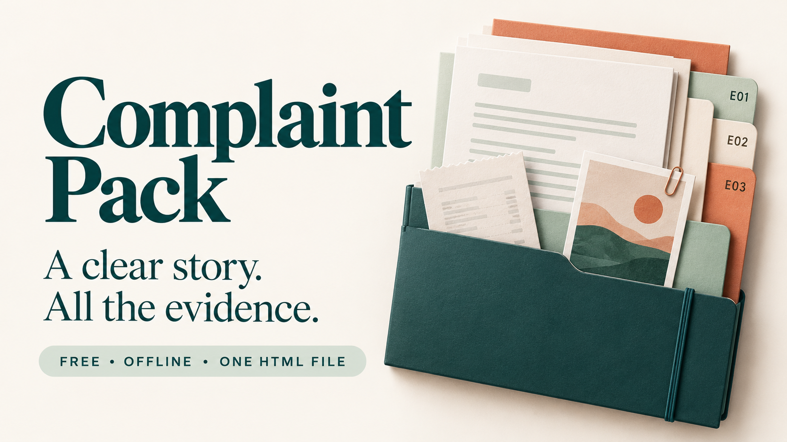

# Complaint Pack

**A clear story. All the evidence.**

A free, offline tool for organising a complaint: the facts, a dated timeline, numbered evidence, an editable message, and a report you can share. Everything runs in one HTML file.

## Start here

1. Extract the ZIP into a folder on your computer.
2. Open **index.html** in your desktop browser. If it opens in a text editor, use **Open with** and choose your browser.
3. Choose **Try a fictional example**, or enter your own case details.
4. Work through **Timeline → Evidence → Your message → Review & export**.
5. Save a **private project** to keep editing later. Download a **shared pack** when you are ready to contact the company.

Only `index.html` is needed to use the app. The remaining files are publishing materials. There is no account, installation, build step, subscription, or internet requirement.

## Features included

| Feature | What it helps you do |
| --- | --- |
| Case details and outcome | Record the company, reference, item, issue, impact, and specific resolution you want |
| Case status | Mark your case Draft, Sent, Waiting, or Resolved |
| Dated timeline | Keep events in order, with undated events after dated ones |
| Contact log | Record a conversation's date, channel, person, and details |
| Numbered evidence | Add receipts, screenshots, photos, or PDFs with titles and captions |
| Stable references | Link events to E01, E02, etc.; numbers stay stable when files are reordered or removed |
| Sharing controls | Keep individual events and attachments out of the shared pack |
| Private notes | Keep your own notes and follow-up date with the editable project |
| Message templates | Choose full, short, or follow-up text in a courteous or direct tone, then edit it |
| Readiness checklist | See missing essentials and useful optional details before sharing |
| Preview and export | Review the report and message, then export selected originals with them |
| Private project backup | Save and reopen the complete editable case, including attachments |
| Optional remembered draft | Keep one active draft in this browser; this is off by default |
| Calendar event | Export your chosen follow-up date for import into a calendar |

The message templates use your entered facts; they do not use AI or contact a service. Copying a message does not send it. Only the company, issue, and specific request are required for a shared export; the checklist's other items are optional.

## Three outputs, three purposes

| Output | Contents | Intended use |
| --- | --- | --- |
| **Save private project** (`.complaint.json`) | Full editable case, all original attachments, private notes and events, sharing settings, and edited message | Keep for yourself and reopen later |
| **Download shared pack** (`.zip`) | `Report.html`, `Message.txt`, instructions, and selected original attachments with an attachment index | Review, then share with the recipient |
| **Print / Save PDF** | Report and image previews, using your browser's print dialog | Print or save a readable report |

**Keep the private project for yourself.** It includes files and notes you excluded from sharing. The app does not encrypt it.

Extract a shared ZIP before opening `Report.html` so its links to files in `attachments/` work. The report has embedded image previews and no scripts. Original attachments keep their original contents and metadata. Image previews are reduced to at most 1,800 pixels on the longest side and flattened onto white; the attached originals are unchanged.

**PDF attachment pages are separate files.** They do not appear inside the report or its printed PDF. The editable message is also separate from the printed report. In the print dialog, choose your paper size, margins, headers/footers, and Save as PDF where available.

## Check what you share

- Contact details are excluded by default; amount paid is included by default. Change these in **Review & export**.
- Mark a timeline event private or uncheck an attachment's inclusion to leave it out of the shared pack.
- Private-note fields, private events, excluded attachments, and your personal follow-up date are omitted from generated shared output.
- **A manually edited message is shared exactly as written.** Sharing switches do not rewrite it. Recheck its text after changing contact, amount, or evidence settings.
- Review the original attachments, including their metadata. This app does not redact or clean them. Remove private details before adding a file.

Inspect both previews and your selected originals, then tick the review checkbox to enable export. Any case change clears that confirmation. The app organises the facts you provide; it does not verify them, submit a complaint, or calculate legal deadlines.

## Saving and follow-ups

Work stays in the current tab until you save a project or turn on **Remember this draft**. Save a project before closing the tab, reloading, or starting another case. **Ctrl/⌘ S** saves a private project. The app keeps one active case; use separate project files for different cases.

Remembering a draft uses this browser's IndexedDB database, without password encryption. Turning it off removes the remembered draft after a successful storage operation. Browser/profile changes, moving the HTML file, private browsing, storage limits, or clearing browser data may make a draft unavailable. Keep a project backup. A storage failure leaves the working case in the tab and displays a warning.

Set **Your follow-up date** under private notes and choose **Save calendar event** to download an `.ics` file. Import it into your calendar and set a reminder there. The app does not send notifications, and the calendar file has no alarm. A requested response date is simply the date you choose to ask for.

## Limits and troubleshooting

One active case; up to **80 timeline events**, **24 attachments**, **12 MB per file**, **30 MB of originals in total**, and a **50 MB project file**. Accepted attachments: still PNG, JPG, WebP, and PDF. Images are limited to 20 megapixels and 16,000 pixels per side. Animated images, SVG, HEIC, Office documents, audio, and video are not supported. PDFs are stored as attachments; their pages are not parsed. Large projects may be slow on devices with limited memory.

Modern desktop browsers with JavaScript enabled are the intended environment. Browser storage, clipboard access, download handling, and printing can vary.

- **Nothing opens:** extract the ZIP and open `index.html` in a browser.
- **Export is disabled:** complete the three required fields and check the review box.
- **A file is rejected:** check its format and limits. Exact duplicate files are skipped.
- **Copy is unavailable:** select the message text and copy it manually.
- **A download does not appear:** check the browser's downloads panel, save-location prompt, and download permissions. “Download requested” means a request was made; the app cannot confirm a file reached your drive.
- **A project will not open:** use a Complaint Pack project within the size limit. Invalid projects leave the current case unchanged. A shared ZIP is not an editable project.
- **A draft disappears:** reopen your saved private project. Browser storage is a convenience, not a backup.

## Files in this package

| File | Purpose |
| --- | --- |
| `index.html` | Complete app and editable source |
| `README.md` | Use and upload guide |
| `Listing-Copy.txt` | Product listing, FAQs, repository copy, and social captions |
| `LICENSE.txt` | MIT license |
| `Images/Banner-Horizontal.png` | Horizontal cover, 1672 × 941 |
| `Images/Banner-Vertical.png` | Vertical promotion, 941 × 1672 |
| `Images/Banner-Square.png` | Square promotion, 1254 × 1254 |
| `Images/Product-Image.png` | Product explainer, 1254 × 1254 |
| `Images/Image-Prompts.txt` | Prompts for the generated artwork |

The four promotional images are conceptual illustrations, not app screenshots.

## Upload guide

### Gumroad

1. Create a digital product titled **Complaint Pack**.
2. Paste the description from `Listing-Copy.txt`.
3. Attach `ComplaintPack-Complete-Package.zip` as the downloadable content.
4. Add the horizontal cover, square thumbnail, and product explainer from `Images`.
5. Set the amount to **$0** and the suggested amount to **$0** if shown. All features belong in the free download.
6. Preview the listing and free download flow, then publish when ready.

Gumroad's free setup uses **$0+ / pay what you want** for a product without priced versions. Include “Enter 0 to download free.” The platform may allow an optional amount; this release has no paid edition or locked features.

Source checked 19 October 2026: [Gumroad pricing guide](https://gumroad.com/help/article/133-pay-what-you-want-pricing).

### GitHub

1. Create a repository named `complaint-pack`.
2. Use **Add file → Upload files** to upload the contents of this `ComplaintPack` folder into the repository root. Keep the `Images` folder and its contents together.
3. Use the repository description and topics in `Listing-Copy.txt`.
4. Attach the complete ZIP to a release named **v1.0.0** for a simple download.

No build command is needed. A static host can serve `index.html` as-is. The downloaded HTML is the intended offline version.

Source checked 19 October 2026: [GitHub upload guide](https://docs.github.com/en/repositories/working-with-files/managing-files/adding-a-file-to-a-repository).

### Other platforms

Upload the ZIP as a free download, paste the supplied copy, and choose the image format that fits. Keep the private-project, original-attachment, and PDF printing notes in your listing.

## Release checks and future ideas

Version **1.0.0 · 19 October 2026**.

**16 automated checks passed** using core tests, a simulated DOM, and native canvas. They covered private project recovery, sharing exclusions, original attachment bytes, ZIP integrity, input validation, message edits, calendar output, draft storage failures, discard confirmation, and the fictional example. ZIP entries and their bytes were also verified independently.

**Live browser interaction and visual/print-layout testing were unavailable.** These checks do not establish cross-browser compatibility. Before a public launch, open the fictional example in your chosen browser, edit it, save and reopen a private project, export and extract its shared ZIP, and try Print / Save PDF. Clipboard, download dialogs, and operating-system printing still need that browser check.

Possible future additions, **not included in this release**: local text recognition to suggest receipt details, PDF page previews, and an optional list of saved cases. The current app keeps the workflow focused on one case and one HTML file.

## Editing and license

CSS, SVG icons, and JavaScript are inline in `index.html`. Open it in a text editor to customise it. Preserve the separation between private projects and shared output when changing export code.

MIT - see `LICENSE.txt`. This release is free with all features included.
